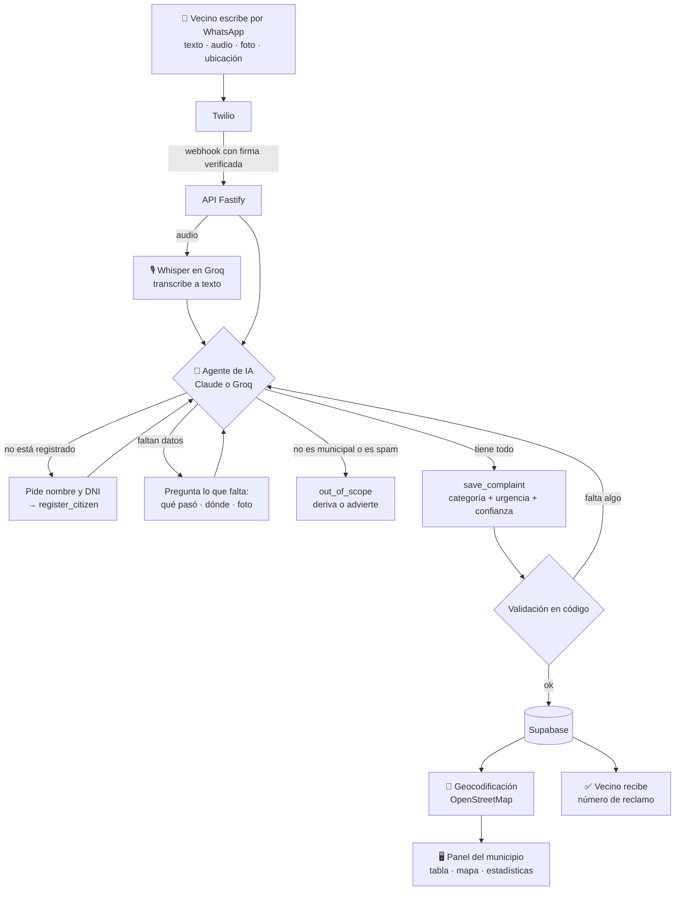

<h1 align="center">🏛 miReclamo</h1>

<p align="center">
  <b>Automatización de reclamos municipales por WhatsApp con inteligencia artificial</b><br/>
  El vecino cuenta el problema como le sale. La IA lo entiende, lo clasifica por categoría y urgencia, y lo carga en el sistema.
</p>

<p align="center">
  
  
</p>

<p align="center">
  
  
  
  
  
  
  
  
  
  
</p>

---

## 📋 Índice

- [¿Qué proceso automatiza?](#-qué-proceso-automatiza)
- [Cómo funciona](#-cómo-funciona)
- [Cómo se usa](#-cómo-se-usa)
- [Clasificación automática](#-clasificación-automática)
- [Funcionalidades](#-funcionalidades)
- [Arquitectura](#-arquitectura)
- [Cómo correrlo](#-cómo-correrlo)
- [Estructura del proyecto](#-estructura-del-proyecto)
- [Seguridad](#-seguridad)
- [Autor](#-autor)

---

## 🎯 ¿Qué proceso automatiza?

### El problema
En la mayoría de los municipios, un reclamo (un poste apagado, un bache, basura acumulada) llega por teléfono, en persona o por redes. Después **un empleado tiene que leerlo, entender de qué se trata, decidir a qué área corresponde, evaluar si es urgente y cargarlo a mano**. Es lento, depende de quién atienda y muchas veces faltan datos: dónde es, quién lo reportó, una foto.

### La solución
miReclamo **automatiza todo ese circuito de recepción y clasificación**:

| Antes (manual) | Con miReclamo (automático) |
|---|---|
| El vecino llama o se acerca en horario de oficina | Escribe por **WhatsApp**, a cualquier hora, con texto o **audio** |
| Un empleado interpreta el reclamo | Un **agente de IA** entiende el mensaje en lenguaje natural |
| Se decide a mano la categoría y el área | La IA asigna **categoría y subcategoría** |
| La prioridad depende del criterio de cada uno | La IA asigna **urgencia** (alta, media o baja) según el riesgo para las personas |
| Faltan datos y hay que volver a llamar | El agente **pide lo que falta**: identidad, ubicación y foto |
| La dirección queda como texto | Se **geocodifica** y aparece en un mapa |
| El vecino no sabe en qué quedó | Recibe un **número de reclamo** y puede consultar el estado por el mismo chat |

El municipio ya no carga reclamos: **los recibe ordenados, priorizados y ubicados en un mapa**, listos para asignar.

---

## ⚙️ Cómo funciona



### Paso a paso

1. **Recepción:** el vecino escribe al número de WhatsApp del municipio. Twilio envía el mensaje a la API, que verifica la firma y responde enseguida para no cortar la conexión.
2. **Transcripción:** si es una nota de voz, se pasa a texto con Whisper y se le muestra al vecino lo que se entendió.
3. **Conversación:** el agente de IA recibe el historial, las categorías activas del municipio y los datos ya juntados. Hace **una pregunta por mensaje**, en español rioplatense.
4. **Identificación:** si es la primera vez, pide nombre y DNI. No se aceptan reclamos anónimos, para poder dar seguimiento.
5. **Datos del reclamo:** pide qué pasó, dónde (calle y altura, esquina, lugar conocido o ubicación compartida) y una foto, o el motivo si no puede mandarla.
6. **Clasificación:** con todo eso, la IA llama a `save_complaint` con la **categoría**, la **urgencia** y su **nivel de confianza**. **Nunca se lo pregunta al vecino**: lo deduce de la descripción.
7. **Validación:** antes de guardar, el código verifica por su cuenta que el vecino esté registrado, que la categoría exista y esté activa, y que haya ubicación y foto o motivo. Si falta algo, se lo devuelve al agente para que lo resuelva. **No depende de que la IA "se porte bien"**.
8. **Registro:** se guarda el reclamo, se geocodifica la dirección y el vecino recibe su número de reclamo.
9. **Gestión:** el reclamo aparece en el panel, ordenado por urgencia y ubicado en el mapa.

---

## 📲 Cómo se usa

### Para el vecino: solo WhatsApp

Sin apps ni formularios. Ejemplo de una conversación:

> 👤 **Vecino:** hola, hay un poste de luz que está tirando chispas y los cables cuelgan
>
> 🤖 **miReclamo:** ¡Hola! Para registrar tu reclamo y poder darle seguimiento, decime tu *nombre y apellido* y tu *DNI*.
>
> 👤 **Vecino:** Juan Pérez, 30123456
>
> 🤖 **miReclamo:** Gracias, Juan. ¿*Dónde* está el poste? Decime calle y altura, una esquina, o compartí tu ubicación (📎 → Ubicación).
>
> 👤 **Vecino:** San Martín y Belgrano
>
> 🤖 **miReclamo:** ¿Podés mandarme una *foto* del poste? No te acerques a los cables.
>
> 👤 **Vecino:** 📷 *[foto]*
>
> 🤖 **miReclamo:** ¡Gracias, Juan! Tu reclamo quedó registrado con el número *5D26D661*. Podés consultar cómo va escribiéndome cuando quieras.

**Resultado en el panel** (sin que nadie lo cargue a mano):

| Campo | Valor asignado automáticamente |
|---|---|
| Categoría | Luminaria → Cables sueltos |
| Urgencia | 🔴 **Alta** (peligro inmediato para las personas) |
| Ubicación | San Martín y Belgrano, con pin en el mapa |
| Evidencia | Foto adjunta |
| Vecino | Juan Pérez |

El vecino también puede:
- 🎙 **Mandar audios** en vez de escribir.
- 📍 **Compartir su ubicación** de WhatsApp en lugar de escribir la dirección.
- 🔎 **Consultar el estado** de sus reclamos: *"¿cómo va mi reclamo 5D26D661?"*

### Para el municipio: el panel web

| Sección | Qué permite |
|---|---|
| **Reclamos** | Tabla con filtros por estado, categoría, urgencia y fechas |
| **Detalle** | Datos, foto, conversación completa, cambio de estado y corrección manual de la urgencia |
| **Mapa** | Todos los reclamos en el mapa, con colores por urgencia |
| **Estadísticas** | Totales, reclamos por categoría y evolución en el tiempo |
| **Categorías** | Alta, edición y baja de categorías y subcategorías. **La IA se adapta sola**: el prompt se arma con las categorías activas |
| **Atención humana** | Un operador puede **tomar la conversación**, responderle al vecino desde el panel y devolvérsela a la IA |

Estados de un reclamo: `Pendiente` → `En proceso` → `Resuelto` / `Rechazado`.

---

## 🧠 Clasificación automática

### Categoría
La IA elige entre las **categorías activas del municipio**, que se cargan desde el panel. Las que vienen de ejemplo:

| Categoría | Subcategorías |
|---|---|
| 💡 Luminaria | Poste apagado · Poste dañado · Cables sueltos |
| 🗑 Limpieza | Basura acumulada en vereda · Contenedor desbordado · Limpieza de zanjón |
| 🚧 Baches y pavimento | Bache en calzada · Vereda rota |
| 🌳 Espacios verdes | Poda de árboles · Mantenimiento de plaza |
| 🚦 Tránsito | Semáforo roto |

Además, la IA registra su **nivel de confianza** (0 a 1). Si después de 5 intercambios no logra clasificar, guarda el reclamo con confianza baja en la categoría más cercana, para que un operador lo revise.

### Urgencia
Se decide según el **riesgo para las personas**:

| Urgencia | Criterio | Ejemplos |
|---|---|---|
| 🔴 **Alta** | Peligro inmediato | Cables sueltos, poste caído, semáforo roto, pérdida de gas |
| 🟡 **Media** | Afecta la circulación o la salubridad | Bache, basura acumulada, luminaria apagada |
| 🟢 **Baja** | Mantenimiento o estético | Poda, pintura, pasto alto |

El sistema guarda si la urgencia la asignó la **IA** o la corrigió un **operador**, así se puede medir qué tan bien clasifica.

### Fuera de alcance y moderación
- **No es municipal** (policía, bomberos, energía, agua, gas…): la IA le explica al vecino a qué organismo corresponde. No suma advertencia, porque el vecino actúa de buena fe.
- **Spam, insultos o charla sin relación**: primer aviso, último aviso y **bloqueo al tercero**. El operador lo puede desbloquear desde el panel.

---

## ✨ Funcionalidades

- 🤖 Agente conversacional con *tool use*: `register_citizen`, `save_complaint`, `check_complaint_status`, `out_of_scope`
- 🔁 **Proveedor de IA intercambiable**: Claude (Anthropic) o un modelo abierto en Groq, configurable con una variable de entorno y sin tocar código
- 🎙 Transcripción de notas de voz con **Whisper** (Groq)
- 📷 Fotos como evidencia, guardadas en un bucket **privado** (se ven con URLs firmadas)
- 📍 Geocodificación con **OpenStreetMap / Nominatim**, que entiende cómo escriben los vecinos: esquinas, lugares conocidos, abreviaturas
- 🗺 Mapa de reclamos con **Leaflet**
- 👤 Registro de vecinos con nombre y DNI. El DNI nunca se le pasa al modelo
- 🧑‍💼 Modo humano: el operador toma la conversación respetando la **ventana de 24 h** de WhatsApp
- 🏛 **Multi-tenant**: preparado para varios municipios en la misma instalación
- 💾 API **stateless**: el estado de cada conversación vive en la base, así que un reinicio no corta los chats en curso

---

## 🏗 Arquitectura

```
miReclamo/
├── apps/api   → Backend: Fastify + agente de IA + webhook de WhatsApp (puerto 3001)
└── apps/web   → Panel del municipio: Next.js 14 (puerto 3000)
                         │
              Supabase (PostgreSQL + Storage)
```

| Capa | Tecnologías |
|---|---|
| **Backend** | Node.js, Fastify, TypeScript, Zod, JWT, bcrypt, rate limiting |
| **IA** | Claude API (Anthropic) o Groq (`gpt-oss-120b`), con *tool use* y Whisper para audios |
| **Mensajería** | Twilio WhatsApp API, con webhooks y firma HMAC |
| **Frontend** | Next.js 14 (App Router), React 18, Tailwind CSS, shadcn/ui, TanStack Table, Recharts, Leaflet, NextAuth |
| **Datos** | Supabase: PostgreSQL con RLS y Storage privado |
| **Geocodificación** | Nominatim (OpenStreetMap), con cola de 1 consulta por segundo según su política de uso |
| **Monorepo** | npm workspaces |

### Modelo de datos

| Tabla | Contenido |
|---|---|
| `tenants` | Municipios (base del modelo multi-tenant) |
| `admin_users` | Operadores del panel, con contraseña hasheada |
| `categories` / `subcategories` | Categorías configurables por municipio |
| `citizens` | Vecinos identificados (nombre y DNI) |
| `sessions` / `messages` | Estado e historial de cada conversación |
| `complaints` | Reclamos con categoría, urgencia, confianza, ubicación y coordenadas |
| `conversation_modes` | Modo IA o humano, advertencias y bloqueos por número |

---

## 🚀 Cómo correrlo

### Requisitos
- [Node.js](https://nodejs.org/) 20 o superior
- Cuenta en [Supabase](https://supabase.com/) (gratis)
- Cuenta en [Twilio](https://www.twilio.com/) con el **WhatsApp Sandbox** (gratis para pruebas)
- API key de [Groq](https://console.groq.com/) (gratis) y/o de [Anthropic](https://console.anthropic.com/)
- [ngrok](https://ngrok.com/), para exponer la API local al webhook de Twilio

### 1. Clonar e instalar
```bash
git clone https://github.com/MatiasZampetti/miReclamo.git
cd miReclamo
npm install
```

### 2. Base de datos
1. Creá un proyecto en Supabase.
2. En el **SQL Editor**, ejecutá **en orden** los archivos de `supabase/migrations/` (del `001` al `006`).
3. Ejecutá `supabase/seed.sql`. Crea el municipio de ejemplo, un usuario administrador y las categorías.

> ⚠️ Cambiá la contraseña del administrador de ejemplo antes de usarlo en un entorno real.

### 3. Variables de entorno

**`apps/api/.env`**
```env
PORT=3001
SUPABASE_URL=https://TU-PROYECTO.supabase.co
SUPABASE_SERVICE_KEY=tu-service-role-key

# Proveedor de IA: groq (gratis) o anthropic
LLM_PROVIDER=groq
GROQ_API_KEY=gsk_...            # también se usa para transcribir audios
ANTHROPIC_API_KEY=sk-ant-...    # solo si LLM_PROVIDER=anthropic

TWILIO_ACCOUNT_SID=AC...
TWILIO_AUTH_TOKEN=...
TWILIO_WHATSAPP_NUMBER=+14155238886

JWT_SECRET=una-cadena-aleatoria-de-al-menos-32-caracteres
DEFAULT_TENANT_ID=00000000-0000-0000-0000-000000000001
WEB_URL=http://localhost:3000
```

**`apps/web/.env.local`**
```env
NEXT_PUBLIC_API_URL=http://localhost:3001
NEXTAUTH_URL=http://localhost:3000
NEXTAUTH_SECRET=una-cadena-aleatoria
```
En el repo hay archivos `.env.example` de referencia en `apps/api/` y `apps/web/`.

> La API valida todas las variables al arrancar y, si falta alguna, indica cuál.

### 4. Levantar el proyecto
```bash
npm run dev:api    # API en http://localhost:3001
npm run dev:web    # Panel en http://localhost:3000
```
En Windows también podés usar `start.ps1`, que levanta todo junto.

### 5. Conectar WhatsApp
1. Exponé la API: `ngrok http 3001`
2. En Twilio → **Messaging → Try it out → WhatsApp Sandbox**, configurá *"When a message comes in"* con:
   ```
   https://TU-URL-DE-NGROK/webhook/twilio
   ```
3. Desde tu celular, uníte al sandbox (mandando el código que indica Twilio) y escribí tu primer reclamo.
4. Entrá al panel en [http://localhost:3000](http://localhost:3000) y vas a ver el reclamo clasificado.

### Scripts
| Comando | Descripción |
|---|---|
| `npm run dev:api` | API en modo desarrollo |
| `npm run dev:web` | Panel en modo desarrollo |
| `npm run build` | Build de los dos proyectos |
| `npm run lint` | Chequeo de tipos y linter |
| `npm run backfill:geo --workspace=apps/api` | Geocodifica reclamos viejos que no tienen coordenadas |

---

## 📁 Estructura del proyecto

```
miReclamo/
├── apps/
│   ├── api/src/
│   │   ├── routes/          # webhook, complaints, categories, stats, auth, tenant
│   │   ├── services/
│   │   │   ├── ai/          # agente, prompt dinámico, herramientas, proveedor de LLM
│   │   │   ├── transcription.ts   # Whisper (audios)
│   │   │   ├── geocoding.ts       # Nominatim
│   │   │   ├── moderation.ts      # advertencias y bloqueos
│   │   │   └── conversation-mode.ts  # modo IA / humano
│   │   └── middleware/      # JWT y verificación de firma de Twilio
│   └── web/
│       ├── app/(dashboard)/ # reclamos, detalle, mapa, estadísticas, categorías
│       └── components/      # mapa, tablas, UI
├── supabase/
│   ├── migrations/          # esquema, urgencia y mapa, modo humano, RLS, moderación, vecinos y evidencia
│   └── seed.sql             # datos iniciales
└── start.ps1                # arranque rápido en Windows
```

---

## 🔐 Seguridad

- **Firma de Twilio verificada** (HMAC) en cada webhook: nadie puede inyectar mensajes falsos.
- **Rate limiting** en la API.
- Panel protegido con **JWT**, y contraseñas con **bcrypt**.
- **Row Level Security** en la base y fotos en un **bucket privado** con URLs firmadas.
- El **DNI no se envía al modelo de IA** ni se repite en el chat.
- Las reglas críticas (identidad, foto, ubicación, categoría válida) se **validan en el código**, no solo en el prompt.
- Variables de entorno validadas con Zod al iniciar.

---

## 👤 Autor

Proyecto integrador de la **Tecnicatura en Desarrollo de Software**, Instituto Superior Villa del Rosario.

**Matías Zampetti**

[](https://matiaszampetti.vercel.app)
[](https://github.com/MatiasZampetti)
[](https://www.linkedin.com/in/matias-zampetti)

---

<p align="center"><sub>Licencia MIT</sub></p>
